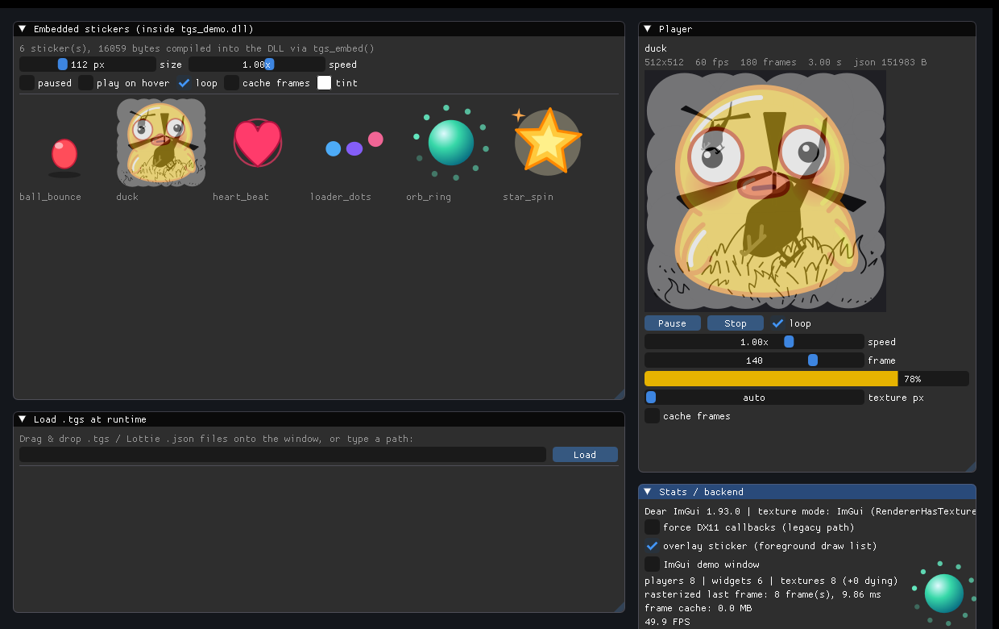

# tgs-parse-imgui

[](../../actions/workflows/build.yml)


Статическая C++17-библиотека для **Telegram-стикеров `.tgs` в Dear ImGui**.
Стикеры **вшиваются в твою `.dll` / `.exe` при компиляции** (одна строка в CMake) и проигрываются одной строкой кода.

```cpp
tgs::ui::Sticker("duck", ImVec2(128, 128));
```



---

## Содержание

- [Возможности](#возможности)
- [Быстрый старт](#быстрый-старт)
- [Сборка](#сборка)
- [Подключение к своему проекту](#подключение-к-своему-проекту)
- [Использование](#использование)
- [Вшивание стикеров (`tgs_embed`)](#вшивание-стикеров-tgs_embed)
- [Текстуры и бэкенды](#текстуры-и-бэкенды)
- [Справочник API](#справочник-api)
- [tgs-tool](#tgs-tool)
- [Пример: DLL + хост](#пример-dll--хост)
- [Как это устроено](#как-это-устроено)
- [Производительность](#производительность)
- [Безопасность и приватность](#безопасность-и-приватность)
- [Совместимость](#совместимость)
- [FAQ и проблемы](#faq-и-проблемы)
- [Структура репозитория](#структура-репозитория)
- [Лицензии](#лицензии)

---

## Возможности

- **`.tgs` → ImGui в одну строку.** Immediate-mode виджеты `Sticker` и `StickerButton` плюс `Player` с полным контролем.
- **Вшивание при сборке.** `tgs_embed(my_dll FILES ...)` превращает файлы в массивы байт внутри бинарника. На диск у пользователя ничего не пишется.
- **Одна `.lib`.** Рендер [rlottie](https://github.com/Samsung/rlottie) (тот же движок, что у Telegram) собран **внутрь** `tgs-parse-imgui.lib`. Сам ImGui внутрь не входит: линкуется твой.
- **Чистая таблица экспорта.** Ни один символ библиотеки не попадает в экспорт твоей DLL: rlottie пропатчен, `stbi_*` скрыты.
- **Свой gzip/DEFLATE-декодер.** Без zlib/miniz. Проверяет CRC32 и ISIZE, ограничивает выход 32 МБ (защита от gzip-бомб). Протестирован против zlib и на порченых данных.
- **Любой рендер-бэкенд.**
  - ImGui ≥ 1.92: текстуры идут через `ImTextureData` автоматически. Работает с DX9/10/11/12, OpenGL2/3, Vulkan, Metal, SDL.
  - ImGui < 1.92, свой рендер или хук: готовые колбэки **DX11 / DX9 / OpenGL** или свои.
- **Плеер:** play/pause/stop, loop, скорость и реверс, перемотка по кадрам и прогрессу, режим «играть при наведении» как в Telegram, кэш кадров, оверлей через `GetForegroundDrawList()`.
- **Экономия CPU.** Растеризация только при смене кадра. Невидимые виджеты не рисуются. Один плеер в нескольких размерах держит одну текстуру.
- **`tgs-tool`**: info, check, embed (для `.vcxproj` без CMake), png, раскадровка, распаковка.

---

## Быстрый старт

**Посмотреть сразу:** запусти `prebuilt/win64/tgs_demo_host.exe`. Это готовое демо, собранное MinGW со статической линковкой.

**Собрать `.lib` под Visual Studio:**

```bat
git clone <this repo> tgs-parse-imgui
cd tgs-parse-imgui
build_vs.bat
```

Результат будет в `dist-x64\` (подробности в разделе [Сборка](#сборка)).

**Подключить к своей DLL через CMake:**

```cmake
add_subdirectory(tgs-parse-imgui)
target_link_libraries(my_dll PRIVATE tgs::tgs)
tgs_embed(my_dll FILES stickers/duck.tgs stickers/cat.tgs)
```

```cpp
#include <tgs/tgs_imgui.h>
// внутри кадра ImGui:
tgs::ui::Sticker("duck", ImVec2(128, 128));
```

---

## Сборка

### Windows / Visual Studio 2019, 2022, 2026

Нужен компонент **«C++ CMake tools for Windows»** из Visual Studio Installer.

```bat
build_vs.bat                          :: x64, встроенный Dear ImGui 1.93.0
build_vs.bat Win32                    :: x86
build_vs.bat x64 C:\dev\my_dll\imgui  :: против ТВОЕЙ копии imgui (рекомендуется)
```

| Результат | |
|---|---|
| `dist-x64\lib\tgs-parse-imgui.lib` | Release, `/MT` |
| `dist-x64\lib\tgs-parse-imgui-d.lib` | Debug, `/MTd` |
| `dist-x64\include\tgs\*.h` | заголовки |
| `dist-x64\bin\tgs-tool.exe` | CLI |
| `dist-x64\bin\tgs_demo_host.exe` + `tgs_demo.dll` | демо |
| `build-x64\tgs_parse_imgui.sln` | решение VS |

Ещё вариант: **VS → File → Open → Folder…**. Есть `CMakePresets.json` с пресетами x64/x86, Debug/Release.

### Linux / MinGW

```sh
./build.sh          # ядро + tgs-tool + тесты; DX11-демо собирается только под Windows
```

### Опции CMake

| Опция | По умолчанию | |
|---|---|---|
| `TGS_IMGUI_DIR` | *(пусто)* | папка с `imgui.h` твоего ImGui. Пусто = встроенный 1.93.0 |
| `TGS_MSVC_STATIC_RUNTIME` | `ON` | `/MT` (как обычно для DLL). `OFF` даёт `/MD` |
| `TGS_BACKEND_DX11` / `DX9` | `ON` на Windows | встроенные колбэки текстур |
| `TGS_BACKEND_OPENGL` | `ON` | колбэки OpenGL (отключаются сами, если нет заголовков GL) |
| `TGS_BUILD_EXAMPLES` / `TOOLS` / `TESTS` | `ON` при сборке как основного проекта | |

> ⚠️ **ImGui должен совпадать.** `.lib` компилируется против конкретных `imgui.h` и `imconfig.h`.
> Если у тебя другая версия ImGui или свой `imconfig.h` (`ImTextureID`, `IMGUI_USE_BGRA_PACKED_COLOR` и т. п.),
> собирай с `TGS_IMGUI_DIR`. Иначе возможны падения из-за несовпадения ABI.

---

## Подключение к своему проекту

### Вариант A: CMake (рекомендуется)

```cmake
# Если у тебя уже есть target `imgui`, библиотека возьмёт его.
# Иначе: set(TGS_IMGUI_DIR "${CMAKE_SOURCE_DIR}/third_party/imgui") до add_subdirectory.
add_subdirectory(third_party/tgs-parse-imgui)

add_library(my_dll SHARED dllmain.cpp overlay.cpp ...)
target_link_libraries(my_dll PRIVATE tgs::tgs)

file(GLOB MY_STICKERS CONFIGURE_DEPENDS "${CMAKE_CURRENT_SOURCE_DIR}/stickers/*.tgs")
tgs_embed(my_dll FILES ${MY_STICKERS})
```

Зависимости (`shlwapi`, потоки) подтягиваются автоматически.

### Вариант B: обычный `.vcxproj` без CMake

1. Собери `build_vs.bat x64 <путь к твоему imgui>`.
2. **C/C++ → General → Additional Include Directories:** `dist-x64\include` и папка твоего imgui.
3. **Linker → Input → Additional Dependencies:** `tgs-parse-imgui.lib` (в Debug — `tgs-parse-imgui-d.lib`). `shlwapi.lib` подключается сам через `#pragma comment`.
4. **C/C++ → Code Generation → Runtime Library:** `/MT` (Release) и `/MTd` (Debug).
5. Скопируй `dist-x64\bin\tgs-tool.exe` в `tools\` решения и добавь **Build Events → Pre-Build Event**:
   ```bat
   "$(SolutionDir)tools\tgs-tool.exe" embed "$(ProjectDir)generated\tgs_embedded.cpp" "$(ProjectDir)generated\tgs_assets.h" $(ProjectName) "$(ProjectDir)stickers"
   ```
   Папка в конце означает «все `*.tgs` в ней». Можно перечислить файлы по одному. Файлы перезаписываются только при изменениях.
6. Собери один раз, добавь `generated\tgs_embedded.cpp` в проект и `generated\` в include-пути.

---

## Использование

### Виджеты (immediate mode)

```cpp
#include <tgs/tgs_imgui.h>
#include "tgs_assets.h"                    // генерируется tgs_embed

tgs::ui::Sticker("duck", ImVec2(128, 128));            // по имени файла без .tgs
tgs::ui::Sticker(tgs_assets::duck, ImVec2(64, 64));    // имя проверяется компилятором

tgs::ui::StickerOptions o;
o.play_on_hover = true;     // стоит на кадре 0, при наведении играет и доигрывает цикл
o.speed = 1.5f;
o.tint = ImVec4(1, 1, 1, 0.8f);
if (tgs::ui::StickerButton(tgs_assets::duck, ImVec2(96, 96), o))
    OnDuckClicked();

// перебрать все вшитые стикеры
for (size_t i = 0; i < tgs::EmbeddedCount(); ++i)
    tgs::ui::Sticker(tgs::EmbeddedAt(i)->name, ImVec2(64, 64));
```

Плееры виджетов кэшируются по ImGui ID. Если виджет не рисуется 120 кадров, плеер удаляется (`SetStickerCacheLifetime`).

### Player: полный контроль

```cpp
static tgs::Player p(tgs::Animation::FromEmbedded("duck"));

p.Draw(ImVec2(256, 256));                 // обычный ImGui-элемент
if (ImGui::Button("Play/Pause")) p.TogglePlay();
p.SetLoop(false);                         // один раз, потом p.IsFinished() == true
p.SetSpeed(-1.0f);                        // реверс
p.SetFrame(30);
p.SetProgress(0.5f);

int frame = p.GetFrame();
if (ImGui::SliderInt("frame", &frame, 0, p.GetFrameCount() - 1)) { p.Pause(); p.SetFrame(frame); }

if (p.DrawButton("##duck", ImVec2(64, 64))) { /* клик */ }
```

### Оверлей без окна (HUD)

```cpp
static tgs::Player hud(tgs::Animation::FromEmbedded("duck"));
hud.DrawTo(ImGui::GetForegroundDrawList(), ImVec2(10, 10), ImVec2(90, 90));
```

### Загрузка в рантайме

```cpp
std::string err;
auto a = tgs::Animation::FromFile("C:/stickers/hi.tgs", &err);   // UTF-8; есть перегрузка std::wstring
auto b = tgs::Animation::FromMemory(ptr, size, &err);             // .tgs / zlib / Lottie JSON
auto c = tgs::Animation::FromJson(json_string, &err);
if (!a) printf("error: %s\n", err.c_str());

tgs::ui::Sticker("hi", a, ImVec2(128, 128));
```

### Только рендер (без ImGui)

```cpp
#include <tgs/tgs.h>
auto anim = tgs::Animation::FromEmbedded("duck");
tgs::Renderer r(anim, 256, 256);
std::vector<uint8_t> rgba(256 * 256 * 4);
r.Render(/*frame*/ 42, rgba.data(), 256 * 4, tgs::PixelFormat::RGBA8);
```

### Завершение: порядок важен

```cpp
ImGui_ImplDX11_Shutdown();
ImGui_ImplWin32_Shutdown();
tgs::Shutdown();          // после бэкенда, до DestroyContext
ImGui::DestroyContext();
// затем release device
```

---

## Вшивание стикеров (`tgs_embed`)

```cmake
tgs_embed(<target>
    FILES a.tgs b.tgs ...      # .tgs (gzip) или Lottie .json
    [PREFIX "pack/"]           # имена станут "pack/a", "pack/b"
)
```

- Имя стикера = имя файла без расширения (+ `PREFIX`). Дубликаты дают ошибку конфигурации.
- Байты пишутся в C++-массив внутри `<target>` и регистрируются при загрузке модуля.
- Генерируется заголовок **`tgs_assets.h`**:
  ```cpp
  namespace tgs_assets {
      inline constexpr const char duck[] = "duck";
      inline constexpr int count = 6;
      inline constexpr const char* all[] = { ... };
      inline constexpr unsigned long long total_bytes = ...;
  }
  #define TGS_REGISTER_ASSETS() ...
  ```
- Изменился `.tgs`: при следующей сборке массив перегенерируется.
- **Static library.** Если вшиваешь в `STATIC`-библиотеку, линкер может выкинуть авто-регистратор. Вызови один раз `TGS_REGISTER_ASSETS();`. Для `.dll` и `.exe` ничего не нужно.
- **Плагины.** Перед выгрузкой DLL, которая регистрировала стикеры в общем реестре, вызови `tgs::UnregisterEmbedded(table, count)`.

---

## Текстуры и бэкенды

| Режим | Когда | Что делать |
|---|---|---|
| `ImGuiManaged` | ImGui ≥ 1.92 и бэкенд с `ImGuiBackendFlags_RendererHasTextures` (все официальные) | ничего |
| `Callbacks` | ImGui < 1.92, свой рендер, хук | `tgs::SetTextureCallbacks(&cb)` |
| `None` | ни то ни другое | виджеты рисуют красный крестик-заглушку |

```cpp
#include <tgs/backends/tgs_dx11.h>          // tgs_dx9.h / tgs_opengl.h
auto cb = tgs::MakeDX11TextureCallbacks(device);
tgs::SetTextureCallbacks(&cb);
printf("%s\n", tgs::GetTextureModeName());
```

| Колбэки | Хэндл (`ImTextureID`) | Формат |
|---|---|---|
| `MakeDX11TextureCallbacks(ID3D11Device*)` | `ID3D11ShaderResourceView*` | RGBA8, dynamic |
| `MakeDX9TextureCallbacks(IDirect3DDevice9*)` | `IDirect3DTexture9*` | A8R8G8B8, `MANAGED` (переживает Reset), на 9Ex `DEFAULT+DYNAMIC` |
| `MakeOpenGLTextureCallbacks()` | `GLuint` | RGBA8, только вызовы GL 1.1 |

Свой рендер:

```cpp
tgs::TextureCallbacks cb;
cb.user_data = my_renderer;
cb.format    = tgs::PixelFormat::RGBA8;     // или BGRA8; альфа не премультиплицирована
cb.create    = [](void* ud, int w, int h) -> uint64_t { /* создать */ return handle; };
cb.update    = [](void* ud, uint64_t t, const void* px, int w, int h, int pitch) { /* залить */ return true; };
cb.destroy   = [](void* ud, uint64_t t) { /* освободить */ };
cb.destroy_delay_frames = 2;                // освобождать через N кадров после последнего использования
tgs::SetTextureCallbacks(&cb);
```

Режим можно переключать на лету: существующие плееры пересоздадут текстуры.

---

## Справочник API

### `<tgs/tgs.h>`: ядро, без ImGui

| | |
|---|---|
| `bool Decompress(data, size, std::string& json, std::string* err = nullptr, size_t max = 32 MB)` | gzip / zlib / JSON → Lottie JSON |
| `bool IsGzip(data, size)` | |
| `Animation::FromEmbedded(name, &err)` | вшитый стикер (кэшируется по имени) |
| `Animation::FromFile(path, &err)` | UTF-8 `std::string` или `std::wstring` |
| `Animation::FromMemory(data, size, &err, name)` | данные копируются |
| `Animation::FromJson(json, &err, name)` | |
| `anim->Info()` | `width, height, fps, frame_count, duration` |
| `anim->Name()`, `anim->Json()` | |
| `Renderer(anim, w, h)` / `Render(frame, dst, pitch, fmt, keep_aspect = true)` | CPU-рендер, `fmt`: `RGBA8`, `BGRA8`, `PremulBGRA8` |
| `ClearEmbeddedCache()` | |

`Animation::Ptr` — это `std::shared_ptr<const Animation>`, его можно свободно передавать между плеерами.

### `<tgs/tgs_imgui.h>`: ImGui

**`tgs::Player`**

| Группа | Методы |
|---|---|
| создание | `Player(anim, PlayerOptions{})`, `SetAnimation(anim, restart)`, `GetAnimation()`, `Valid()`, `Options()` |
| воспроизведение | `Play()`, `Pause()`, `Stop()`, `TogglePlay()`, `IsPlaying()`, `IsFinished()` |
| параметры | `SetLoop/GetLoop`, `SetSpeed/GetSpeed` (отрицательная = реверс) |
| позиция | `SetFrame/GetFrame`, `GetFrameCount`, `SetTime/GetTime`, `SetProgress/GetProgress` |
| время | `Update(dt)`. Вызывается сам из `Draw*`, если `auto_update = true` |
| рисование | `Draw(size, tint, bg)`, `DrawButton(id, size, tint)` → `bool`, `DrawTo(draw_list, a, b, col)` |
| низкий уровень | `SetResolution(w, h)`, `Prepare(w, h)`, `GetTexID()`, `GetTexRef()` (≥ 1.92), `ReleaseTexture()` |

Размер `<= 0` в `Draw`: по ширине берётся доступная ширина, по высоте — с сохранением пропорций.

**`PlayerOptions`**: `autoplay = true`, `loop = true`, `speed = 1`, `auto_update = true`, `cache_frames = false`, `max_resolution = 1024`.

**`tgs::ui`**

| | |
|---|---|
| `Sticker(name, size, opts)` | вшитый стикер. `false`, если не найден |
| `Sticker(str_id, anim, size, opts)` | любая загруженная анимация |
| `StickerButton(...)` | то же, но возвращает `true` при клике |
| `GetStickerPlayer(str_id)` | плеер, который стоит за виджетом |

**`StickerOptions`**: `speed`, `loop`, `paused`, `play_on_hover`, `cache_frames`, `tint`, `bg`.

**Служебное:** `SetTextureCallbacks`, `GetTextureMode`, `GetTextureModeName`, `NewFrame` (необязательно), `SetStickerCacheLifetime`, `GarbageCollect`, `Shutdown`, `GetStats` (плееры, текстуры, кадры за последний кадр ImGui, мс, кэш).

### `<tgs/tgs_embed.h>`: реестр

`FindEmbedded(name)`, `EmbeddedCount()`, `EmbeddedAt(i)` (отсортировано по имени), `RegisterEmbedded`, `UnregisterEmbedded`.

---

## tgs-tool

```
tgs-tool info   <file.tgs|dir>...                    размер, fps, кадры, длительность, соответствие требованиям Telegram
tgs-tool check  <file.tgs|dir>...                    валидация, код возврата 1 при ошибке (для CI / pre-build)
tgs-tool embed  <out.cpp> <out.h> <id> <file|dir>... то же, что tgs_embed() в CMake
tgs-tool png    <file.tgs> <out.png> [frame] [size]  кадр в PNG
tgs-tool sheet  <file.tgs> <out.png> [cols] [cell] [frames]   раскадровка
tgs-tool unpack <file.tgs> <out.json>                распаковать в Lottie JSON
```

---

## Пример: DLL + хост

`examples/dll_dx11/`:

- **`tgs_demo.dll`** содержит Dear ImGui, DX11, tgs-parse-imgui и все `assets/*.tgs`, вшитые при сборке. Экспортирует `tgs_demo_run()`, `tgs_demo_sticker_count()`, `tgs_demo_sticker_name(i)`.
- **`tgs_demo_host.exe`** грузит DLL по **полному пути** (без подмены через порядок поиска DLL), печатает список вшитых стикеров и запускает окно.

В окне есть:
- сетка вшитых стикеров с настройками размера, скорости, паузы, hover, tint и кэша;
- Player с таймлайном;
- загрузка `.tgs` в рантайме: drag & drop на окно или путь;
- статистика;
- переключение `ImGui-managed ↔ DX11 callbacks` на лету;
- оверлей-стикер в углу.

Свой стикер: положи `.tgs` в `examples/dll_dx11/assets/` и пересобери. Если файл называется `duck.tgs`, он сразу откроется в Player.

Проверить, что стикер действительно внутри DLL: удали `.tgs` из `assets/` и запусти хост **без пересборки**. Стикер останется.

---

## Как это устроено

```
 сборка:   assets/*.tgs ──tgs_embed──► const unsigned char[] в .rdata твоей DLL
 рантайм:  массив ─► inflate (свой, CRC32) ─► Lottie JSON в RAM ─► rlottie (модель кэшируется)
           ─► растеризация кадра (CPU, ARGB premul) ─► RGBA straight ─► ImTextureData / колбэк ─► GPU
```

- `.tgs` — это gzip-сжатый Lottie JSON (у Telegram: 512×512, 30 или 60 fps, до 3 с, до 64 КБ).
- rlottie считает кадры как `[ip, op]` включительно, но слои Lottie видны на `[ip, op)`. Библиотека отбрасывает пустой последний кадр, поэтому зацикленная анимация не мигает.
- Текстуры освобождаются отложенно, когда бэкенд гарантированно перестал их использовать. Так нет падений при удалении стикера посреди кадра.

---

## Производительность

- Кадр растеризуется **только при смене номера кадра**. Стикер на 60 fps даёт не больше 60 растеризаций в секунду.
- Виджеты за пределами окна или скролла не растеризуются, время у них идёт дальше.
- Разрешение текстуры = экранный размер × `DisplayFramebufferScale`. `PlayerOptions::max_resolution` ограничивает его сверху.
- `cache_frames = true`: после первого цикла CPU не тратится. Память: `кадры × w × h × 4` (180 кадров 128×128 ≈ 11 МБ).
- Под MSVC rlottie использует обычный C-путь без SSE2 (его SSE2-код использует расширения GCC/Clang). Держи разумные размеры или включай кэш.
- `tgs::GetStats().render_ms` показывает, сколько ушло на растеризацию в последнем кадре.

---

## Безопасность и приватность

- **На диск ничего не пишется.** Распаковка, разбор и рендер идут только в памяти. Проверено трассировкой: за весь self-test ни одного открытия файла на запись. Логирование rlottie выключено при компиляции.
- **Экспорт DLL чистый.** Видны только твои собственные экспорты.
- **Вшитые данные не зашифрованы.** Они лежат в `.rdata` как обычный gzip (сигнатура `1F 8B 08`) и легко вырезаются инструментами вроде `binwalk`. Во время работы распакованный JSON лежит в RAM. Если это важно, шифруй данные до `tgs_embed` и расшифровывай перед `FromMemory`.
- **Недоверенные файлы:** лимит 32 МБ на распаковку, проверка CRC и размера, отказ при битых или обрезанных данных. Декодер протестирован на сотнях искажённых входов (без падений и без молча принятых битых данных) и под ASan/UBSan.

---

## Совместимость

| | Статус |
|---|---|
| Dear ImGui 1.93.0 (встроенный) | ✅ self-test |
| Dear ImGui 1.92.0 | ✅ self-test (учтены отличия `RegisterUserTexture` и `ImTextureData::Create`) |
| Dear ImGui 1.89.9 | ✅ self-test (режим колбэков) |
| GCC 13, Linux x64 | ✅ сборка, тесты, ASan/UBSan |
| MinGW-w64 GCC 13, Windows x64 | ✅ сборка, тесты, демо (Wine) |
| MSVC x64 / Win32 | собирается в CI (GitHub Actions), см. бейдж вверху |
| Стандарт | C++17 (rlottie собирается как C++14) |

---

## FAQ и проблемы

**Вместо стикера красный крестик.**
Либо имя не найдено (проверь `tgs::FindEmbedded("name")` и `tgs_assets::`), либо нет текстурного бэкенда: `GetTextureMode() == None`. Для ImGui < 1.92 или своего рендера вызови `SetTextureCallbacks`.

**`LNK2038: mismatch detected for 'RuntimeLibrary'`.**
Runtime library проекта не совпадает с либой. Либа по умолчанию собирается с `/MT` и `/MTd`. Либо поменяй проект, либо собери либу с `-DTGS_MSVC_STATIC_RUNTIME=OFF`.

**Падение внутри ImGui при рисовании.**
Почти всегда это несовпадение версии ImGui или `imconfig.h`. Пересобери либу с `TGS_IMGUI_DIR` = твой imgui.

**Стикеры, вшитые в STATIC-библиотеку, не находятся (`FindEmbedded` → `nullptr`).**
Линкер выкинул авто-регистратор. Вызови `TGS_REGISTER_ASSETS();` или вшивай прямо в `.dll`/`.exe`.

**Стикер тормозит.**
Уменьши размер, включи `cache_frames` или задай `SetResolution`. Посмотреть нагрузку можно в `GetStats()`.

**Нужен 32-битный билд.**
`build_vs.bat Win32`.

**Где брать `.tgs`?**
Любой стикер Telegram (через бота или экспорт) или свой Lottie, сжатый gzip. Lottie `.json` тоже принимается. Учитывай права на изображения.

---

## Структура репозитория

```
tgs-parse-imgui/
├─ include/tgs/
│  ├─ tgs.h                 ядро: Decompress, Animation, Renderer
│  ├─ tgs_imgui.h           Player, tgs::ui::*, текстуры, Shutdown, Stats
│  ├─ tgs_embed.h           реестр вшитых стикеров
│  └─ backends/             tgs_dx11.h, tgs_dx9.h, tgs_opengl.h
├─ src/                     реализация (tgs_inflate.cpp — DEFLATE/gzip/zlib)
├─ cmake/
│  ├─ TgsEmbed.cmake        функция tgs_embed()
│  ├─ TgsEmbedGen.cmake     генератор (cmake -P, при сборке)
│  ├─ TgsRlottie.cmake      rlottie → object library → внутрь .lib
│  └─ TgsImGui.cmake        target `imgui`
├─ examples/dll_dx11/       tgs_demo.dll + tgs_demo_host.exe, assets/*.tgs
├─ tools/                   tgs-tool, make_sample_stickers.py (генератор демо-стикеров)
├─ tests/                   self-test: inflate, реестр, рендер, жизненный цикл текстур ImGui
├─ third_party/             rlottie (vendored + PATCHES.md), Dear ImGui 1.93.0
├─ prebuilt/win64/          готовое демо и tgs-tool (MinGW, static)
├─ docs/                    скриншот
├─ .github/workflows/       CI: MSVC x64/Win32 + Linux
├─ build_vs.bat, build.sh, CMakePresets.json
└─ LICENSE, THIRD_PARTY_NOTICES.md
```

Перегенерировать демо-стикеры: `python tools/make_sample_stickers.py`.

---

## Лицензии

- Код библиотеки: **MIT**, см. [`LICENSE`](LICENSE).
- rlottie: MIT, части под FreeType License, Skia, pixman, stb, RapidJSON и MPL-2.0 (`vinterpolator.cpp`). Dear ImGui: MIT. Подробности в [`THIRD_PARTY_NOTICES.md`](THIRD_PARTY_NOTICES.md).
- `examples/dll_dx11/assets/duck.tgs` — стикер Telegram, добавленный для теста. **Не покрывается лицензией проекта.**
